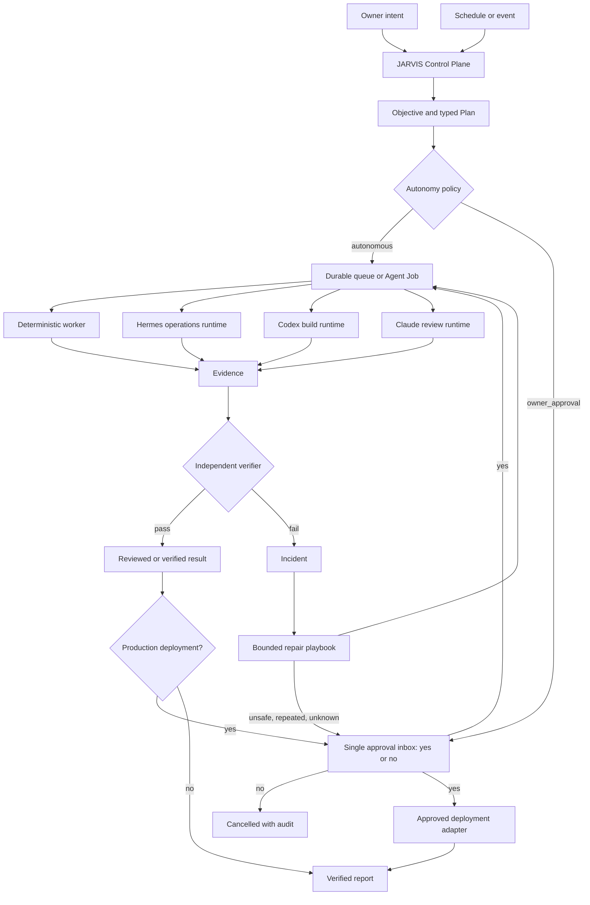

# JARVIS Operating System Architecture

## Big Picture

JARVIS is a governed venture operating system. The Owner sets direction and the autonomy boundary. JARVIS turns intent into accountable Objectives, selects the correct specialist Runtime, enforces policy, observes evidence, detects failures, triggers repair, escalates only when necessary, and closes the loop with a verified report.

The system is intentionally not a group chat of agents. Every component has one authority:

| Component | Authority | Must never do |
|---|---|---|
| Owner | Direction, policy changes, exceptional approval, risk acceptance | Bypass audit or evidence |
| JARVIS Control Plane | Plan, route, gate, schedule and report | Claim code ran or a deployment succeeded |
| Hermes | Operate tools, skills, schedules, browser, research, monitoring and operational repair playbooks | Be the sole author of code or the sole approver of its own work |
| Codex | Implement scoped code and tests in a bounded workspace | Merge, deploy, rotate credentials or contact third parties |
| Claude Code | Independent architecture, security and code review; optional second implementation opinion | Approve its own implementation or bypass deployment policy |
| Worker | Execute allowlisted deterministic tools | Mutate production or approve work |
| Verifier | Re-observe evidence and mark Tasks verified | Execute the original mutation or grant approval |
| Operations Monitor | Detect heartbeat, health, lease, queue and recovery failures | Hide an Incident or silently retry indefinitely |
| Deployment Adapter | Dispatch an approved project workflow and verify its result | Bypass Owner approval or direct root access |

## System Flow

## Agent Division of Labour

### JARVIS

JARVIS owns the operating model: Objective creation, model routing, autonomy policy, approvals, queueing, scheduling, incident escalation, deployment gates and final reporting. It is the only component allowed to declare an Objective complete, and only from verifier-produced evidence.

### Hermes

Hermes is the **Operations, Skills and Tool Supervisor**. Its demonstrated capabilities include 104 enabled skills, cron, projects, kanban, memory, browser/computer use, approvals, fallback providers and monitoring. It should handle research, browser workflows, operational checks, evidence gathering, knowledge and tool orchestration.

Hermes should not be the default code author. Using it as a generic coder discards its strongest advantage and overlaps Codex. Hermes may call Codex or Claude through an approved handoff, summarize their outputs, and run operational verification.

### Codex

Codex is the primary **bounded build executor**. It works in a project workspace under `workspace-write`, produces commits/diffs/test evidence, and returns a result to JARVIS. It cannot merge to a protected branch or deploy without an Owner decision. The verified route is OpenRouter's free model router; the Mac bridge reads the key from the `jarvis-openrouter` Keychain item rather than a project file.

### Claude Code

Claude Code is the **independent reviewer and second opinion**. It is valuable for architecture, security, repository-wide reasoning and adversarial review of Codex changes. It can implement when selected, but its default role is review. Its model is independently routable; the current OpenRouter-compatible path is validated, while the installed plain `claude` path is misconfigured and must not be treated as healthy.

## Trigger Contract

Every Trigger has one owner, one precondition set and one next state. A handler must be idempotent.

| Trigger | Producer | Authoritative handler | Next state |
|---|---|---|---|
| `mission.created` | Owner or schedule | Control Plane | Objective draft |
| `objective.planned` | Planner | Autonomy engine | queued or awaiting approval |
| `approval.granted` | Owner or autonomy rule | Control Plane | queue or dispatch |
| `task.executed` | Worker | Verifier | verified or incident |
| `task.verification_failed` | Verifier | Incident classifier | repair or escalation |
| `agent_job.completed` | Hermes/Codex/Claude bridge | Verifier or review gate | accepted result or incident |
| `build.verified` | Verifier | Control Plane | review request or deployment request |
| `review.passed` | Claude reviewer or verifier | Control Plane | deployment request |
| `deployment.requested` | Control Plane | Approval inbox | awaiting Owner decision |
| `deployment.succeeded` | Deployment adapter | Health verifier | verified report or incident |
| `heartbeat.missed` | Operations monitor | Incident classifier | recover or alert |
| `incident.repair_exhausted` | Repair dispatcher | Control Plane | Owner decision or failed report |

## Failure and Repair Model

Failures are classified before any retry. Blind retries are prohibited for policy failures and evidence failures.

| Failure class | Examples | Default action |
|---|---|---|
| `transient` | timeout, temporary 5xx, rate limit | Retry with bounded backoff |
| `model_route` | model missing, provider unavailable, hallucinated tool | Switch to an approved free route or stop |
| `tool_contract` | invalid input, unsupported tool | Repair input only if deterministic; otherwise fail |
| `workspace` | dirty tree, missing repo, wrong branch | Quarantine and create a clean worktree |
| `evidence` | missing proof, false commit claim | Fail closed; independently re-check |
| `policy` | approval missing, permission denied | Escalate to Owner; no autonomous override |
| `infrastructure` | service down, disk full, database unavailable | Run safe operational playbook |
| `unknown` | unclassified or repeated failure | Escalate to Owner |
